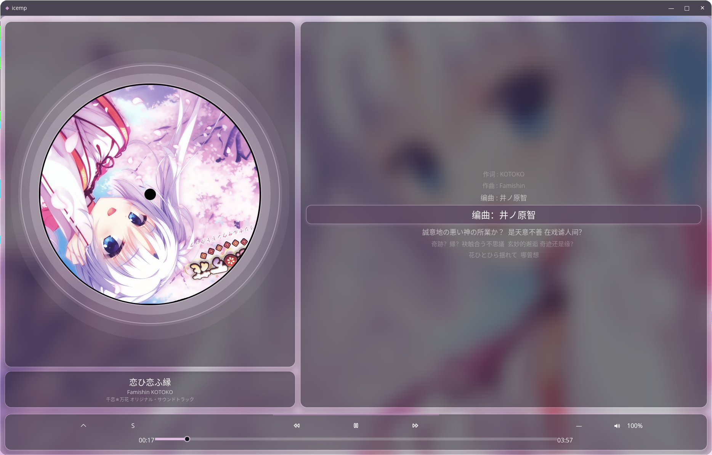

<p align="center">
  
</p>

<h1 align="center">icemp</h1>

<p align="center">
  A simple local music player built with Rust and Iced.
</p>

<p align="center">
  <a href="LICENSE"></a>
  
  
</p>

## 简介

`icemp` 是一个使用 Rust 编写的本地桌面音乐播放器，基于 Iced 0.14、rodio 和 lofty。它提供本地音乐库播放、专辑封面、多行 LRC 歌词、在线歌词下载，以及音频响应式的视觉动效。

## 功能

- 本地音乐文件夹扫描与播放
- 读取音频标题、艺术家、专辑、时长和内嵌封面
- 播放、暂停、上一首、下一首
- 播放进度拖动与音量调节
- 随机播放和列表循环、单曲循环
- 本地 LRC 歌词加载
- 在线歌词自动下载
- 多歌词源自动回退：
  - LRCLIB
  - 网易云音乐
  - QQ 音乐
- 配置文件持久化音乐目录、歌词目录、音量和歌词源优先级
- 多行歌词显示，当前歌词高亮
- 歌单当前歌曲定位
- 唱片旋转、低频响应光晕和播放器栏动效
- 无边框透明圆角窗口与自定义标题栏

## 界面

<p align="center">
  
</p>

<p align="center"><em>icemp 播放界面：唱片、歌曲信息、多行歌词与悬浮播放器栏</em></p>

项目使用自定义无边框窗口，包含：

- 自定义标题栏：拖动、最小化、最大化、关闭和边缘缩放
- 封面页：唱片、歌曲信息、多行歌词和音效动效
- 播放列表页：搜索来源、目录选择、歌词源优先级、当前歌曲定位
- 半透明悬浮播放器栏

## 构建与运行

### 环境要求

- Rust toolchain，支持 Edition 2024
- Linux 构建通常需要 ALSA 和窗口系统开发库

Ubuntu/Debian 可安装：

```bash
sudo apt update
sudo apt install build-essential pkg-config libasound2-dev libxkbcommon-dev libwayland-dev
```

如果使用 X11 而不是 Wayland，可能还需要安装对应的 X11 开发包。

### 运行

```bash
git clone https://github.com/bks34/icemp.git
cd icemp
cargo run --release
```

也可以直接构建：

```bash
cargo build --release
```

生成的程序位于：

```text
target/release/icemp
```

## 配置

配置文件使用 TOML 格式，由 `dirs` 根据当前操作系统选择配置目录。

Linux 默认位置：

```text
~/.config/icemp/config.toml
```

配置示例：

```toml
music_path = "/home/user/Music"
lyrics_path = "/home/user/Music/lyrics"
volume = 1.0
auto_download_lyrics = true
lyrics_source_priority = "lrclib"
```

`lyrics_source_priority` 可用值：

```toml
lyrics_source_priority = "lrclib"
lyrics_source_priority = "netease"
lyrics_source_priority = "qq_music"
```

当前首选来源会排在第一位，其余来源仍作为自动回退。

## 歌词

本地歌词按照以下文件名查找：

```text
歌词目录/艺术家 - 标题.lrc
```

如果本地歌词不存在，播放器会根据配置自动尝试在线下载。在线歌词接口为公开 Web 接口，可能受网络环境、地区或频率限制影响。

播放列表工具栏中的歌词源按钮支持：

- 单击：删除已有歌词并重新下载当前歌曲歌词
- 滚轮向上/向下：切换歌词源优先级

## 快捷键

| 快捷键 | 功能 |
| --- | --- |
| `Space` | 播放 / 暂停 |
| `←` | 上一首 |
| `→` | 下一首 |
| `↑` | 增大音量 |
| `↓` | 减小音量 |
| `Enter` | 切换播放列表页与播放页 |

## Debian 打包

项目包含 `cargo-deb` 所需的包元数据：

```bash
cargo deb
```

生成的 Debian 包位于：

```text
target/debian/
```

## 项目结构

```text
src/
├── main.rs            # Iced 应用入口和窗口配置
├── audio_analysis.rs  # 低频音频特征和音频响应数据
├── config.rs          # TOML 配置读写
├── lyrics_download.rs # 多歌词源查询、匹配和下载
├── song.rs            # 音频元数据、封面和 rodio 播放封装
└── ui/
    ├── ui.rs          # 主要界面、状态、事件和样式
    ├── lyrics.rs      # LRC 解析、多行歌词索引
    └── utils.rs       # 主题和封面强调色提取
```

## 依赖

主要依赖：

- [Iced](https://iced.rs/)：GUI 和 WGPU 渲染
- [rodio](https://github.com/RustAudio/rodio)：音频播放
- [lofty](https://github.com/Serial-ATA/lofty-rs)：音频元数据
- [image](https://github.com/image-rs/image)：图片处理
- [libblur](https://github.com/ksk001100/libblur)：封面高斯模糊
- [reqwest](https://github.com/seanmonstar/reqwest)：歌词网络请求

## 许可证

本项目使用 [MIT License](LICENSE)。

在线歌词来自第三方公开服务。请遵守对应服务的使用条款，并仅下载和保存你有权使用的歌词内容。
